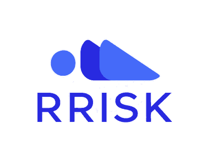
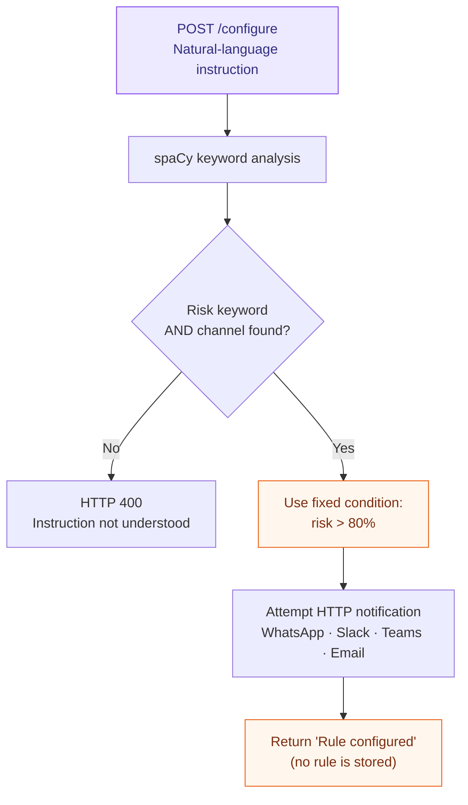
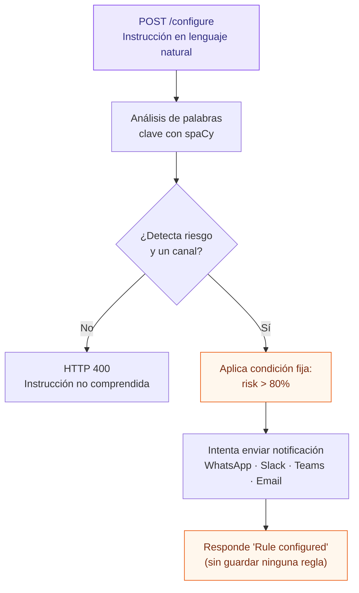

<div align="center">



### RRISK | Natural-language risk alerts · Proof of Concept

**Rounver · Experimental project · February 2025**


**[English](#english) · [Español](#español)**

</div>

---

<a id="english"></a>
## English

### At a glance

**RRISK** is a small proof of concept exploring how a user could describe a risk alert in plain language and trigger notifications through different communication channels.

**Example intent:** “If the risk score exceeds 80%, notify the team through Slack and email.”

> **Historical prototype, not a working risk-monitoring platform.** The repository contains demonstration logic, placeholder integrations, and no production deployment configuration.

### What is actually implemented

- A Flask HTTP server with two endpoints: `POST /configure` and `POST /ai`.
- Basic keyword extraction through spaCy (`en_core_web_sm`).
- A **hard-coded** condition, `risk > 80%`, whenever a risk-related keyword appears.
- Detection of notification channel names: WhatsApp, Slack, Microsoft Teams, and email.
- Experimental HTTP requests to notification endpoints, without production authentication or delivery verification.
- A sequential attempt to select an AI endpoint (OpenAI → OpenRouter → Groq → local Ollama → local Mistral).

### Prototype flow



### API surface

| Endpoint | Purpose | Important caveat |
| --- | --- | --- |
| `POST /configure` | Parses text and attempts channel notifications immediately | Does **not** create, persist, or monitor rules |
| `POST /ai` | Attempts to call the first AI provider passing a basic availability check | The probes and request/response schema are not compatible with reliable real-world provider use |

Illustrative request:

```bash
curl -X POST http://127.0.0.1:5000/configure \
  -H "Content-Type: application/json" \
  -d '{"text":"If risk exceeds 80%, notify via Slack and email"}'
```

**Attention:** This route attempts outbound HTTP requests. It can report “Notification sent” without verifying successful delivery. Use only in an isolated development environment.

### Technology

| Layer | Technology |
| --- | --- |
| HTTP service | Python, Flask |
| Natural-language parsing | spaCy, `en_core_web_sm` |
| Network calls | Requests |
| Planned AI providers | OpenAI, OpenRouter, Groq, Ollama, Mistral |
| Planned notification channels | WhatsApp, Slack, Microsoft Teams, SendGrid |

### Local exploration

```bash
python -m venv .venv
# Activate the virtual environment for your operating system
pip install flask requests spacy
python -m spacy download en_core_web_sm
python POC-Integrations.py
```

The script starts Flask with `debug=True`. **Do not expose it to the public internet.** Dependencies are not pinned, credentials are not configured, and there is no automated test suite.

### What is not implemented

- Real risk scoring, data sources, thresholds, or continuous monitoring.
- A persistent rules engine, database, or scheduler.
- Validated authentication or authorization for the HTTP endpoints.
- Production-ready provider authentication, payloads, retries, and delivery confirmations.
- Production deployment, logging strategy, or operational safeguards.

### Why keep this repository?

It preserves an early Rounver experiment in **natural-language automation and AI-provider fallback**. The value here is the idea and its history, not a reusable production service.

**License:** Released under the [MIT License](./LICENSE). Copyright © 2025–2026 Rounver Corp. You may use, modify, and redistribute this proof of concept, including commercially, subject to the license terms. The code is provided as-is, without warranties or a commitment to support.

**Feedback and maintenance:** [GitHub Issues](https://github.com/rounverr/pocrrisk/issues) are welcome for reporting problems or suggesting improvements. The official repository is maintained exclusively by Rounver; external pull requests and code contributions are not accepted. See [CONTRIBUTING.md](./CONTRIBUTING.md).

---

<a id="español"></a>
## Español

### Resumen

**RRISK** es una pequeña prueba de concepto que explora cómo describir una alerta de riesgo en lenguaje natural y activar notificaciones a través de diferentes canales.

**Ejemplo de intención:** «Si la puntuación de riesgo supera el 80 %, notificá al equipo por Slack y correo electrónico».

> **Prototipo histórico, no plataforma operativa de monitoreo de riesgos.** El repositorio contiene lógica demostrativa, integraciones incompletas y ninguna configuración de despliegue de producción.

### Qué está implementado realmente

- Un servidor HTTP con Flask y dos endpoints: `POST /configure` y `POST /ai`.
- Extracción sencilla de palabras clave mediante spaCy (`en_core_web_sm`).
- Una condición **fija**, `risk > 80%`, al encontrar palabras relacionadas con riesgos.
- Detección de canales: WhatsApp, Slack, Microsoft Teams y correo electrónico.
- Solicitudes HTTP experimentales a servicios de notificación, sin autenticación de producción ni verificación de entrega.
- Selección secuencial tentativa de proveedores de IA (OpenAI → OpenRouter → Groq → Ollama local → Mistral local).

### Flujo del prototipo



### Endpoints

| Endpoint | Función | Limitación principal |
| --- | --- | --- |
| `POST /configure` | Analiza un texto e intenta notificar de inmediato | **No** crea, almacena ni supervisa reglas |
| `POST /ai` | Intenta consultar el primer proveedor de IA que supera una prueba básica de disponibilidad | Las comprobaciones y el formato de las solicitudes no son confiables para integraciones reales |

Ejemplo ilustrativo:

```bash
curl -X POST http://127.0.0.1:5000/configure \
  -H "Content-Type: application/json" \
  -d '{"text":"If risk exceeds 80%, notify via Slack and email"}'
```

**Atención:** Este endpoint intenta realizar solicitudes HTTP externas. Puede indicar que envió una notificación sin comprobar la entrega. Utilizar únicamente en un entorno de desarrollo aislado.

### Tecnologías

| Capa | Tecnología |
| --- | --- |
| Servidor HTTP | Python, Flask |
| Procesamiento de texto | spaCy, `en_core_web_sm` |
| Solicitudes de red | Requests |
| Proveedores de IA previstos | OpenAI, OpenRouter, Groq, Ollama, Mistral |
| Canales de notificación previstos | WhatsApp, Slack, Microsoft Teams, SendGrid |

### Exploración local

```bash
python -m venv .venv
# Activar el entorno virtual según el sistema operativo
pip install flask requests spacy
python -m spacy download en_core_web_sm
python POC-Integrations.py
```

El script ejecuta Flask con `debug=True`: **no debe exponerse a Internet**. No hay versiones de dependencias fijadas, credenciales configuradas ni pruebas automatizadas.

### Qué falta por implementar

- Cálculo real de riesgos, fuentes de datos, umbrales y monitoreo continuo.
- Motor de reglas persistente, base de datos y programador de tareas.
- Autenticación y autorización robustas en los endpoints.
- Integraciones reales con credenciales, formatos correctos, reintentos y confirmación de entregas.
- Despliegue productivo, observabilidad y controles operativos.

### ¿Por qué conservarlo?

Documenta una exploración temprana de Rounver sobre **automatización mediante lenguaje natural y alternativas entre proveedores de IA**. Su valor es histórico y conceptual; no constituye un servicio listo para reutilizar.

**Licencia:** Publicado bajo la [Licencia MIT](./LICENSE). Copyright © 2025–2026 Rounver Corp. Se permite usar, modificar y redistribuir esta prueba de concepto, incluso comercialmente, conforme a la licencia. El código se entrega tal cual, sin garantías ni compromiso de soporte.

**Comentarios y mantenimiento:** Se pueden abrir [GitHub Issues](https://github.com/rounverr/pocrrisk/issues) para informar problemas o proponer mejoras. El repositorio oficial lo mantiene exclusivamente Rounver; no se aceptan pull requests ni contribuciones de código externas. Consultar [CONTRIBUTING.md](./CONTRIBUTING.md).

---

<div align="center">
  <sub>Built as an experiment · Preserved as part of Rounver's engineering history</sub>
  <br/>
  <sub>Creado como experimento · Conservado como parte de la historia de ingeniería de Rounver</sub>
</div>
